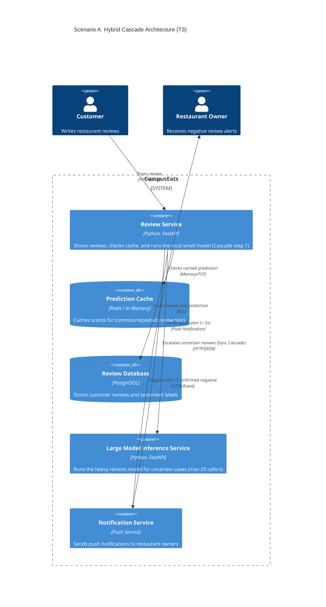

# Task 4: Deployment topologies and trade-offs

**Name / ชื่อ:** Sippakorn Thunyahan

**Student ID / รหัสนิสิต:** 6631355721

This is **individual work**: each student completes and submits their own copy, in their own fork.

_งานนี้เป็น**งานเดี่ยว** นิสิตแต่ละคนทำและส่งงานของตัวเอง ใน fork ของตัวเอง_

**Scenario (A, B or C) / Scenario ที่เลือก:** A — Owner alerts

Choose **one** scenario below. If the last digit of your student ID is odd, take A or B; if it is even, take B or C. Use your measurements from Tutorial 6 as evidence: cite run names from `results/runs.csv`. Answer in Thai or English.

เลือก scenario **หนึ่ง** ข้อด้านล่าง ถ้าเลขตัวสุดท้ายของรหัสนิสิตเป็นเลขคี่ ให้เลือก A หรือ B ถ้าเป็นเลขคู่ ให้เลือก B หรือ C ใช้ผลการวัดจาก tutorial ที่ทำไปเป็นข้อมูลอ้างอิง โดยอ้างชื่อ run จาก `results/runs.csv` จะตอบเป็นภาษาไทยหรือภาษาอังกฤษก็ได้

Facts that hold in every scenario / ข้อเท็จจริงที่ใช้กับทุก scenario:

- The large model serves at most **20 calls per second** (4 calls at once × about 200 ms each), and every call costs money.

  _large model รับได้สูงสุด **20 calls ต่อวินาที** (พร้อมกัน 4 calls × ประมาณ 200 ms ต่อ call) และทุก call มีค่าใช้จ่าย_

- The small model is fast and cheap enough to run anywhere, including inside the review service or on a kiosk, but it is much less accurate on its own.

  _small model เร็วและถูกพอที่จะรันที่ไหนก็ได้ รวมถึงภายใน review service หรือบน kiosk แต่ถ้าใช้ตัวเดียวจะแม่นน้อยกว่ามาก_

## Scenarios

**A. Owner alerts.** When a customer posts a negative review, the restaurant owner gets a push notification within **2 seconds**. At the lunch peak, CampusEats receives **40 reviews per second**. A missed alert is acceptable, but a wrong alert (for example, "your customer is unhappy" when they are happy) makes owners stop trusting alerts and, in the end, ignore them.

_เมื่อลูกค้าโพสต์รีวิวเชิงลบ เจ้าของร้านจะต้องได้รับ push notification ภายใน **2 วินาที** เวลาช่วงพีคตอนเที่ยง CampusEats ได้รับรีวิวจำนวน **40 รายการต่อวินาที** การพลาด alert ไปบ้างนั้นยอมรับได้ แต่ alert ที่ผิด (เช่น "ลูกค้าไม่พอใจ" ทั้งที่จริงๆ แล้วพอใจ) จะทำให้เจ้าของร้านไม่เชื่อถือและเลิกสนใจ alert ในที่สุด_

**B. Canteen kiosk.** A tablet in each canteen lets students leave a review on the spot. However, the canteen Wi-Fi is poor: the tablets lose their connection several times a day, for minutes at a time. The system must accept every review, even while a tablet is offline. Restaurant owners need the labels **by the end of the day**.

\*มี tablet ในแต่ละโรงอาหารให้นิสิตรีวิวได้ทันที อย่างไรก็ดี การเชื่อมต่อ Wi-Fi ในโรงอาหารไม่ดี ทำให้ tablet หลุดการเชื่อมต่อวันละหลายครั้ง ครั้งละหลายนาที ระบบจะต้องรับรีวิวได้ทุกรายการแม้ขณะที่กำลัง offline อยู่ และเจ้าของร้านต้องการ label **ภายในสิ้นวัน\***

**C. Weekly report.** Restaurant owners want a weekly sentiment report. Nothing in producing this report has to be real-time. **Accuracy matters most** and **cost must be minimal**.

\*เจ้าของร้านต้องการรายงาน sentiment รายสัปดาห์ ไม่มีอะไรที่จะต้องทำแบบ real-time ในการออกรายงานนี้ ความแม่นยำ **(accuracy) สำคัญที่สุด** และ **ค่าใช้จ่ายต้องน้อยที่สุด\***

## Topologies and patterns to choose from / Topology และ pattern ที่เลือกใช้ได้

|     | Topology                        | Where the model runs / โมเดลรันที่ไหน                                                                                                           |
| --- | ------------------------------- | ----------------------------------------------------------------------------------------------------------------------------------------------- |
| T1  | Model as a service, synchronous | Inference service, called for each review (today's baseline) _inference service ถูกเรียกทุกรีวิว (baseline ของวันนี้)_                       |
| T2  | Model as a library              | Inside the review service, or on the device _ภายใน review service หรือบนอุปกรณ์_                                                             |
| T3  | Hybrid                          | Small model locally, large model as a remote service _small model รันในเครื่อง large model เป็น remote service_                              |
| T4  | Asynchronous / batch            | Reviews are queued (broker, W10) or stored, and scored later in bulk _รีวิวถูกเข้าคิว (broker, W10) หรือเก็บไว้ แล้วติด label ทีหลังเป็นชุด_ |

Combine one topology with any of the patterns from Tutorial 6: **fallback**, **cascade** and **cache**.

\*เลือก topology หนึ่งแบบ แล้วผสมกับ pattern จาก Tutorial 6 ได้ตามต้องการ: **fallback**, **cascade** และ **cache\***

## 1. Quality requirements

The three most important quality requirements for your scenario, each with a number where possible.

_quality requirements ที่สำคัญที่สุด 3 ข้อของ scenario ที่เลือก ระบุตัวเลขเมื่อทำได้_

| #   | Quality    | Requirement                                                                                                             |
| --- | ---------- | ----------------------------------------------------------------------------------------------------------------------- |
| 1   | latency    | Owner must receive a push notification within 2 seconds of a negative review being posted                               |
| 2   | throughput | System must handle 40 reviews/second at lunch peak while keeping remote calls ≤ 20 calls/second                         |
| 3   | precision  | Minimize false-positive alerts (high precision), as wrong alerts destroy owner trust while missed alerts are acceptable |

## 2. Design / การออกแบบ

T3: A fast, small model runs locally inside the Review Service, and a large model runs as a separate remote Inference Service.
Cascade: Every review is scored by the local small model first. Confident predictions finish immediately. Only uncertain reviews are sent to the remote large model.

Fallback: Because missed alerts are acceptable, if the remote large model times out, fails, or hits its 20 calls/second limit, the system safely drops the alert (or falls back to no-alert) rather than sending a risky guess or breaching the 2-second deadline.

Cache: An in-memory cache stores predictions for exact duplicate or common short review texts (e.g., "Good", "Great food") to skip model inference altogether.

## 3. Evidence / หลักฐาน

Which runs support your choice? Show the numbers and, for scenario A, the capacity arithmetic: how many large-model calls per second does your design need at the peak?

_run ไหนที่สนับสนุนการตัดสินใจของนิสิต ให้นิสิตแสดงตัวเลขประกอบ และสำหรับ scenario A ให้นิสิตแสดงการคำนวณ capacity ด้วย เพื่อแสดงว่าในช่วงพีคนั้น design ของนิสิตต้องใช้ large model กี่ calls ต่อวินาที_

| Run         | What it shows / แสดงอะไร                                                                                                     |
| ----------- | ---------------------------------------------------------------------------------------------------------------------------- |
| `t2-0.8`    | Cascade threshold 0.8, cache off: p50 450 ms, p95 567 ms, accuracy 93.5%, large calls 64%, errors 0, pending 0.              |
| `t3-cache`  | Cascade threshold 0.8, cache on: p50 7 ms, p95 551 ms, accuracy 93.5%, large calls 40%, cache hits 34%, errors 0, pending 0. |
| `t1-before` | Hang rate 0.1, large strategy, cache off: p50 247 ms, p95 426 ms, errors 20, pending 0, accuracy 92.8%.                      |
| `t1-after`  | Hang rate 0.1, large strategy, cache off: p50 401 ms, p95 1010 ms, errors 0, pending 28, accuracy 93.0%.                     |

**Capacity Arithmetic:**

- **Lunch peak traffic:** 40 reviews/second.
- **Large model limit:** 20 calls/second.
- **Cascade only (`t2-0.8`):** Sends 64% of reviews to the large model: 40 \* 0.64 = **25.6 calls/second**. This exceeds the 20 calls/second limit and overloads the service.
- **Cascade + Cache (`t3-cache`):** A 34% cache hit rate lowers large-model calls to 40%: 40 \* 0.40 = **16 calls/second**. Since 16 <= 20, the system stays safely under the capacity limit.

**What the Evidence Establishes—and What It Doesn't:**

- **What it establishes:** `t3-cache` proves that combining cascade and cache keeps prediction fast (p95 = 551 ms, well under the 2-second deadline) and keeps peak large-model calls within capacity (16 calls/s <= 20 calls/s). `t1-after` proves that the fallback pattern handles service hangs with 0 errors by marking hung requests as pending (which can be retried later in the background or skipped without sending an alert, since missed alerts are acceptable).
- **What it assumes and doesn't establish:**
  1. **Traffic assumptions:** Applying the 40% large-call rate to lunchtime traffic assumes real lunchtime reviews will also have a 34% cache hit rate (repeated text) and the same ambiguity distribution as the test set, arriving smoothly without sudden micro-bursts above 40 reviews/s.
  2. **Incorrect alerts (Trust):** The runs only measure overall accuracy (93.5%), which combines false alarms and missed alerts. To properly evaluate owner trust, we also need **Precision** (or **False Positive Rate**) on the negative-review class specifically.
  3. **End-to-end latency:** The 551 ms p95 latency only measures model prediction; actual push notification delivery time and background retry queueing delays remain unverified.

## 4. ADR

Title: Use T3 Hybrid Topology with Cascade, Cache, and Fallback for Owner Alerts
Status: Proposed
Context: CampusEats must send push alerts to restaurant owners within 2 seconds when a negative review is posted. Lunchtime traffic peaks at 40 reviews/second, but our accurate large model can only handle 20 calls/second. Wrong alerts (false positives) ruin owner trust, while missing an occasional alert is acceptable.

Decision: We will use T3 (Hybrid) topology combined with Cascade, Cache, and Fallback patterns. When a review arrives, the Review Service checks a local cache first. On a cache miss, a fast local small model scores the review. If the small model is confident, it acts immediately. Only uncertain reviews cascade synchronously to the remote large model. Only high-confidence negative predictions trigger the Notification Service. If the remote large model times out or is overloaded, the fallback policy suppresses the alert rather than guessing.

Consequences:
Positive: Easily meets the 2-second deadline and stays under the 20 calls/second limit by filtering most traffic locally. High precision from the large model on tricky reviews protects owner trust.

Negative: Higher maintenance complexity because engineers must deploy, monitor, and update two different models (local small and remote large) in two separate places.

Alternatives considered:
T1 (Synchronous model as a service): Rejected because sending all 40 reviews/second directly to a large model that only handles 20 calls/second causes massive queues, timeouts, and violates the 2-second limit.

T2 (Model as a library): Rejected because running the large model inside the Review Service takes too much memory/CPU, while running only the small model locally produces too many false alarms and hurts owner trust.

T4 (Asynchronous / batch): Rejected because waiting for batch queues or background polling easily delays notifications past the strict 2-second deadline.

>
